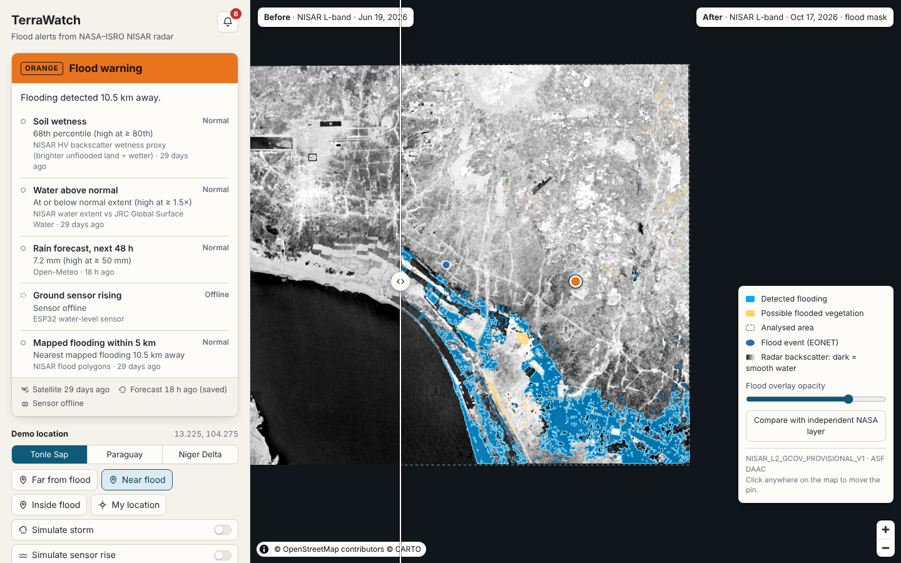

# TerraWatch: radar flood alerts

Flood monitoring and tiered alerts from the NASA–ISRO **NISAR** radar satellite, combined with
rainfall forecasts and a live ESP32 ground sensor. Built solo for the NASA Space Apps Challenge 2026,
challenge "Dancing with the SARs".

**Live demo:** https://terra-watch-radar-flood-alerts.vercel.app

> Hackathon prototype. TerraWatch supplements, but does not replace, official emergency alerts.



*The basemap is missing from this screenshot because it was captured offline; the live site shows it.*

## What it does

- **Maps flooding from NISAR.** It compares a before and an after L-band radar image and flags land
  that turned dark, which is how smooth open water looks to radar.
- **Gives an alert level for any point on Earth.** Five signals feed four tiers, GREEN to RED, and
  every alert shows which signals fired and how old each piece of data is.
- **Explains itself.** Cached AI briefings restate the computed results for a resident, an emergency
  manager, a farmer or a student. The AI never detects floods or picks the tier.
- **Reaches the physical world.** An ESP32 shows the tier on an LED, LCD and buzzer, and its water
  sensor feeds one of the five signals back in.

### Analysed regions

| Region | Before → after | Newly flooded | Kind |
|---|---|---|---|
| Tonle Sap, Cambodia | 19 Jun → 17 Oct 2026 | 494 km² | Seasonal flood pulse |
| Paraguay (EONET_20898) | 18 Jun → 30 Jun 2026 | 53 km² | NASA EONET flood event |
| Inner Niger Delta, Mali | 24 Jun → 10 Oct 2026 | 748 km² | Seasonal flood |

Outside these regions the app says so, looks up when NISAR last imaged the point, and bases the tier
on the rain forecast and ground sensor alone. That gap is the main known limitation.

### Alert tiers

| Tier | Meaning | Rule |
|---|---|---|
| RED | Flood imminent or occurring | Location is inside a mapped flood area, or three or more signals are high |
| ORANGE | Flood warning | Mapped flooding within 25 km, or two signals are high |
| YELLOW | Flood watch | One ground signal (wetness or water above normal) plus heavy rain forecast |
| GREEN | No current concern | Otherwise |
| BLUE | Global report | A flood elsewhere in the world (EONET feed) |

Signals: soil wetness (NISAR HV proxy), water above normal (NISAR vs JRC baseline), rain forecast
≥ 50 mm in 48 h (Open-Meteo), ground sensor rising (ESP32), mapped flooding within 5 km.
Thresholds live in one file: `web/public/data/config.json`.

## How it fits together

```
pipeline/ (Python, local)  ──exports──▶  web/public/data/<region>/   static site on Vercel
ESP32 ──PUT reading──▶ Firebase Realtime Database ◀──poll── browser (tier engine + Turf.js)
ESP32 ◀──GET /api/tier (Vercel function running the same tier engine)
```

- `pipeline/` finds NISAR pairs, reads only the area of interest from each granule, detects flooding
  and exports images, polygons and statistics.
- `web/` is a Vite + React + MapLibre app. `web/src/shared/tier.ts` is the single tier engine, used
  by the browser and by `web/api/tier.js`.
- `firmware/terrawatch_esp32/` is the Arduino sketch.

## Method, in brief

1. Read HH and HV gamma-0 backscatter for the area from the before and after granules (20 m, averaged to 40 m).
2. Convert to dB, apply a 5 × 5 median filter, and take after minus before.
3. Choose the change threshold with Otsu's method, and require the after image to be below −15 dB.
4. Remove permanent water (JRC occurrence ≥ 80 %), slopes over 5°, and patches under 1 ha.
5. Flag brightening under tree cover as possible flooded vegetation (L-band double bounce).
6. Turn patches of at least 1 km² into alert polygons; smaller ones stay on the map image only.

Limits: the map shows the after-image date, not today; a 12-day revisit leaves gaps; wind-roughened
water and wet smooth fields can be confused; nothing has been validated on the ground.

## Run it

### Web app

```bash
cd web
npm install
npm run dev        # local preview
npm test           # tier engine tests
```

### Pipeline

Needs Python 3.11+ and a free [NASA Earthdata Login](https://urs.earthdata.nasa.gov/users/new).

```bash
python -m venv .venv && source .venv/bin/activate     # Windows: .venv\Scripts\activate
pip install -r pipeline/requirements.txt
cp .env.example .env                                  # add Earthdata and LLM credentials

python pipeline/01_discover.py --regions              # events with before/after NISAR pairs
python pipeline/02_inspect.py <granule name>          # optional: print a granule's layout
```

Define a region in `REGIONS` in `pipeline/config.py`, then for each region id:

```bash
python pipeline/03_fetch.py    --region <id>          # NISAR window + JRC, DEM, WorldCover
python pipeline/04_detect.py   --region <id>          # flood change detection
python pipeline/05_export.py   --region <id>          # writes web/public/data/<id>/
python pipeline/06_briefings.py --region <id>         # cached AI briefings
python pipeline/06_briefings.py --global              # briefings for unanalysed places
```

### ESP32

Open `firmware/terrawatch_esp32/terrawatch_esp32.ino` in the Arduino IDE, copy `secrets.example.h`
to `secrets.h`, and fill in Wi-Fi, site and Firebase addresses. The pin table is at the top of the
sketch. `firmware/serial_bridge.py` relays over USB if Wi-Fi is unavailable.

## Credits and licence

All data, libraries, services and AI tools are listed in [CREDITS.md](CREDITS.md).
Code is released under the [MIT License](LICENSE).
